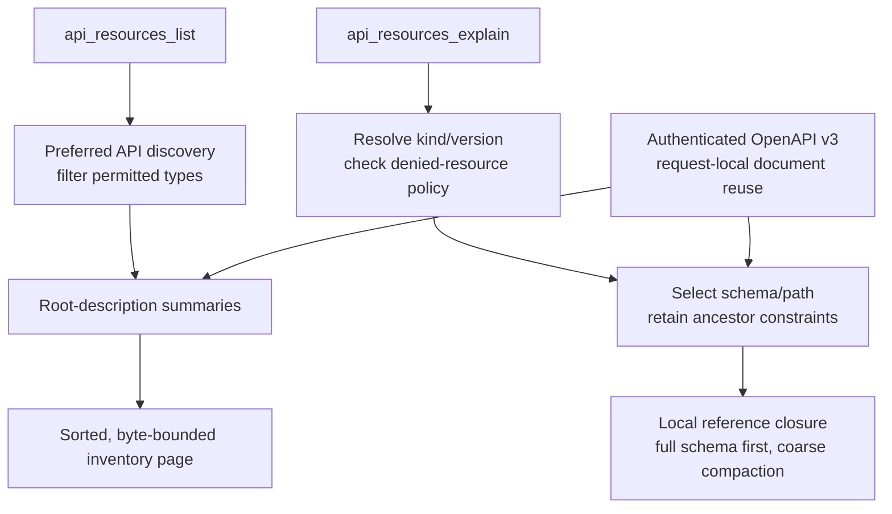

# API discovery architecture

The `core` toolset exposes two complementary operations: discover API types with
`api_resources_list`, then inspect a selected type with `api_resources_explain`.
A known kind can go directly to explain. The [runtime specification](api-discovery.md)
defines arguments, response fields, limits and recovery examples.

## Data flow

Both operations use the selected Kubernetes client's credentials. They read discovery
and OpenAPI endpoints, not CRD objects or resource instances. Tool handlers and MCP
serialization preserve the same structured data and recovery guidance in text output.

## Responsibilities

| Layer | Responsibility |
|---|---|
| [Core handlers](../../pkg/toolsets/core/resources.go) | Register tools, validate arguments, apply configured policy and wrap actionable errors |
| [Discovery](../../pkg/kubernetes/api_discovery.go) | Read discovery/OpenAPI, resolve canonical identity, summarize descriptions and page inventory |
| [Schema rendering](../../pkg/kubernetes/api_schema.go) | Traverse paths/references, retain validation context and render within the response budget |
| [MCP conversion](../../pkg/mcp/) | Preserve structured errors and enforce the independent server-wide result limit |

Schema documents are reused only within one call, including failed fetches. Retrieval
uses client-go's OpenAPI v3 reader, preserving workspace URL prefixes and hash queries.
There is no cross-call schema cache.

## Design decisions

| Decision | Rationale |
|---|---|
| Separate inventory and explain | Each has one purpose; `kubectl explain` supplies a familiar operation name. Adding schema modes to instance tools would obscure data and authorization boundaries |
| Consistent `kind` / `apiVersion` selectors | Avoid competing plural/alias grammars. A unique kind resolves its preferred version; ambiguity requires an explicit choice |
| Name-only substring search | Predictable filtering without implying semantic relevance from description text, negative statements or synonyms |
| Short root descriptions | Help selection without turning inventory into full-text search. Quality comes from source documentation, not generated summaries |
| Server-managed byte paging | Entry sizes vary. Explicit totals, remaining counts and recovery instructions make partial results visible |
| Snapshot-bound continuation | Recomputing the inventory and checking its fingerprint avoids silently skipping entries after filters, policy or source content change |
| Full-schema-first rendering | Small schemas need no refinement. Large schemas need structure-aware omissions rather than arbitrary depth cuts or raw text truncation |
| Branches before descriptions | Preserve surrounding semantic context and validation details; collapse expensive descendants before shortening retained descriptions |
| Separate success and completeness | MCP `isError` identifies failed operations; `complete` identifies omitted content in usable results |

The 16 KiB inventory and 24 KiB schema budgets count serialized application JSON,
including response metadata. They are measured starting points, not established
optimal context sizes for every model or harness.

**Not included in this iteration:** plural/short-name selectors and returned aliases,
description/semantic search, cross-call schema caching, domain-aware field prioritisation,
schema lookup folded into list, instance-reference expansion/dynamic enums and dry-run
validation. These are separate design choices, not implied follow-up commitments; LLM
summarization is explicitly excluded.

## Schema rendering

Path traversal follows local references and `allOf`, traversing arrays/maps implicitly.
Alternative schemas remain explicit rather than being merged into one supposed type.
Narrowed views retain labelled ancestor constraints, including sibling-dependent CEL;
this is context, not a guarantee of complete admission validation.

Rendering copies the selected view and retains reachable definitions at their local
reference addresses. If the full response exceeds its budget, a deterministic
size-based heuristic collapses property branches, recomputes reference closure and
measures the serialized result. It makes at most three coarse simplifications, with
in-tree markers and path-based expansion arguments. Retained long descriptions are
a later fallback; indivisible oversized constraints fail explicitly.

There is no domain-specific ordering: `spec` does not outrank `status` or metadata.
Expansion must expose additional detail rather than repeat the same collapsed boundary.
Cycle/work guards fail explicitly; the renderer never uses an LLM or edits source schemas.

## Boundaries and verification

Instance references are not schema references. The server does not look up catalogue
choices, synthesize enums, infer controller workflows or perform dry-run admission.
Read-only annotations do not confer Kubernetes access; configured denied-resource
policy filters inventory/candidates and blocks explain before schema fetch.

Deterministic tests cover byte limits, paging continuity, search, missing descriptions,
canonical identity, implicit containers, references/compositions, ancestor CEL,
omission recovery and text/structured error equivalence using generic fixtures and
native MCP integration.
